<!-- themed-header:start -->
<a href="https://likhith-ng-portfolio.vercel.app/#proj-greekshield"></a>

<p align="center">
  <a href="https://likhith-ng-portfolio.vercel.app/#proj-greekshield"></a>
  <a href="https://github.com/LikhithNG"></a>
</p>

**At a glance**

- Moved 1M+ options records from AWS S3 through a 6-layer Snowflake medallion architecture in under 5 minutes, cutting market-data preparation time by 70%.
- Computed all 5 Black-Scholes Greeks as Snowflake UDFs for each contract and portfolio, feeding 4 Cortex AI agents and LLM strategy agents that flag concentrated risk.

---
<!-- themed-header:end -->

# Greek Shield

**Options risk analytics with Black-Scholes Greeks, LLM-assisted agents, Slack alerts and a Streamlit dashboard**

[](https://www.snowflake.com/)
[](https://aws.amazon.com/s3/)
[](https://www.python.org/)
[](https://streamlit.io/)
[](https://slack.com/)

---

## Project Overview

Greek Shield is an options risk monitoring system for a single underlying (AAPL by default). Python scripts pull option chains from Yahoo Finance, archive them to AWS S3, load them into a Snowflake table, compute Black-Scholes Greeks, and generate plain-English risk reports. A set of Python agents (strategy, logistics, financial control) reads the Snowflake data, optionally uses an LLM (OpenAI by default, Anthropic supported) for reasoning and explanations, and surfaces results through a Streamlit dashboard and Slack webhooks.

**Developed by Team 2:**
Likhith Nagaralu Gurumurthy | Manvith Reddy Dalli | Sneh Patel

**Course:** DAMG 7374 17610 - Gen AI with Applications in Data Engineering
**Institution:** Northeastern University
**Term:** Fall 2025

> **Scope of this repository.** This repo contains the Python side of the project. The course design also called for Snowflake-native objects (a layered RAW/DATA/FEATURES/PROCESSED/ALERTS/AGENTS schema, scheduled tasks, UDFs, Cortex procedures). Those objects, and any DDL for them, are **not** included here. The code reads two of them (`PROCESSED.DAILY_RISK_SUMMARY`, `ALERTS.RISK_ALERTS`) but nothing in this repo creates or populates them. See [Required Snowflake tables](#required-snowflake-tables).

---

## Problem Statement

Options traders need to track how exposure changes as prices, implied volatility and time to expiry move:

1. **Manual risk tracking** - Computing Delta, Gamma, Theta, Vega and Rho across a whole option chain by hand is slow and error-prone.
2. **Recalculation** - Greeks go stale as soon as the underlying price, IV or days to expiry change.
3. **Awareness lag** - Without automation, exposure changes may go unnoticed until after the fact.
4. **Interpretability** - Raw Greek values do not explain why a position is risky or what to watch.

---

## What the code does

- **Ingestion pipeline** (`final_complete_pipeline.py`) - Yahoo Finance (via `yfinance`) → S3 (JSON + CSV) → Snowflake `OPTIONS_SNAPSHOT`, then builds a text risk report from `PROCESSED.DAILY_RISK_SUMMARY` and `ALERTS.RISK_ALERTS` and writes it to `risk_reports/`.
- **Black-Scholes Greeks** (`calculate_greeks.py`) - Computes Delta, Gamma, Theta, Vega and Rho in Python (NumPy/SciPy) for rows in `OPTIONS_SNAPSHOT` with no Greeks yet, and writes them back. Contracts without a usable implied volatility are skipped and counted rather than priced with a made-up IV.
- **Agents** (`agents/core/`):
  - `StrategyAgent` / `EnhancedStrategyAgent` - reads recent market data and portfolio risk from Snowflake, picks a strategy with an LLM (rule-based fallback when no LLM is configured), and adds plain-English summaries, scenario analysis and confidence scoring.
  - `LogisticsAgent` - filters available contracts by DTE and liquidity.
  - `FinancialAgent` - rule-based budget and risk-limit checks.
  - `OrchestratorAgent` - runs the three agents in sequence.
- **Plain-English risk monitor** (`risk_monitor_agent.py`) - console dashboard explaining the latest Greeks.
- **Slack alerts** (`utils/slack_manager.py`) - optional webhook notifications (`SLACK_ALERTS_ENABLED=true`).
- **Streamlit dashboard** (`streamlit_dashboard.py`) - runs the agent workflow interactively and charts the results.

Not included: a scheduler (run the pipeline with cron or similar), Snowflake UDFs/tasks/Cortex code, a natural-language query interface, or a governance layer that blocks trading advice. The strategy agent does produce strategy recommendations; treat them as educational output, not financial advice.

---

## Quickstart

Requirements: Python 3.10-3.12 (the pinned NumPy/SciPy versions do not support 3.13), a Snowflake account with the tables listed below, an S3 bucket, and optionally OpenAI/Anthropic API keys and a Slack webhook.

```bash
# 1. Create and activate a virtual environment
python3 -m venv .venv
source .venv/bin/activate

# 2. Install dependencies
pip install -r requirements.txt

# 3. Configure credentials
cp .env.example .env
# edit .env with your Snowflake, AWS, LLM and Slack settings

# 4. Ingest today's option chain (entry point)
python final_complete_pipeline.py

# 5. Compute Greeks for newly loaded contracts
python calculate_greeks.py

# 6. Launch the dashboard
streamlit run streamlit_dashboard.py
```

Other entry points:

- `python run_enhanced_system.py` - run the full agent workflow from the command line (writes to `agent_outputs/`).
- `python risk_monitor_agent.py` - plain-English risk dashboard in the terminal.
- `python analyze_greeks.py`, `python verify_data.py`, `python check_table_structure.py` - inspection helpers.
- `fetch_to_s3.py`, `load_to_snowflake_fixed.py`, `yahoo_to_s3_to_snowflake.py` - earlier, standalone versions of the ingestion steps. `yahoo_to_s3_to_snowflake.py` targets an older `OPTIONS_SNAPSHOT` column layout and does not match the one used by the rest of the code.

Configuration notes:

- If no OpenAI key is configured, agents log a warning and fall back to rule-based logic.
- `OPENAI_MODEL` (default `gpt-4o-mini`) and `ANTHROPIC_MODEL` (default `claude-sonnet-4-5`) select the LLM.
- `SNOWFLAKE_INSECURE_MODE=true` disables TLS certificate validation for Snowflake. It defaults to off; only enable it for local debugging of certificate issues.

---

## Required Snowflake tables

The DDL for these tables is not in this repo (the course TA provisioned `OPTIONS_SNAPSHOT`). The columns below are the ones the code reads or writes; column types are not recorded here.

| Table | Used by | Columns referenced |
|-------|---------|--------------------|
| `OPTIONS_SNAPSHOT` (connection's default schema) | pipeline, `calculate_greeks.py`, agents, dashboard | `SNAPSHOT_TS`, `SYMBOL`, `CONTRACT_SYMBOL`, `OPTION_TYPE`, `STRIKE`, `EXPIRY`, `BID`, `ASK`, `LAST_PRICE`, `VOLUME`, `OPEN_INTEREST`, `IMPLIED_VOL`, `UNDERLYING_PRICE`, `DTE`, `ID_MD5`, `DELTA`, `GAMMA`, `THETA`, `VEGA`, `RHO` |
| `RISK_MONITOR.PROCESSED.DAILY_RISK_SUMMARY` | pipeline report, `StrategyAgent` | `ASOF_DATE`, `TICKER`, `NET_DELTA`, `NET_GAMMA`, `NET_THETA`, `NET_VEGA`, `NET_RHO`, `N_CONTRACTS`, `N_ITM`, `N_OTM`, `N_ATM` |
| `RISK_MONITOR.ALERTS.RISK_ALERTS` | pipeline report | `GENERATED_TIMESTAMP`, `TICKER`, `EXPIRATION_DATE`, `STRIKE_PRICE`, `OPTION_TYPE`, `AGENT_NAME`, `SEVERITY`, `ALERT_TYPE`, `PLAIN_ENGLISH_SUMMARY`, `RECOMMENDATION`, `CURRENT_DELTA`, `CURRENT_GAMMA`, `CURRENT_THETA`, `CURRENT_VEGA`, `DAYS_TO_EXPIRATION` |
| `FEATURES.OPTIONS_GREEKS` | part of the Snowflake-side design only | not referenced by any query in this repo |

If `DAILY_RISK_SUMMARY` or `RISK_ALERTS` is missing, the pipeline still loads data but the risk report contains an error message, and the strategy agent reports portfolio risk as `unknown`.

---

## System Architecture

The diagram below shows the full course design, including the Snowflake-native layers that are not part of this repo.

<p align="center">
  
</p>

### Data flow implemented in this repo

**Yahoo Finance** (`yfinance`)
↓
**AWS S3** (JSON + CSV archive per day)
↓
**Snowflake `OPTIONS_SNAPSHOT`** (row inserts from Python)
↓
**`calculate_greeks.py`** (Black-Scholes in Python, written back to Snowflake)
↓
**Agents** (Snowflake queries + optional LLM)
↓
**Outputs:** text risk reports, Streamlit dashboard, optional Slack alerts

---

## User Flow

<p align="center">
  
</p>

1. Run the ingestion pipeline and Greeks calculation (manually or on a schedule you set up).
2. Open the Streamlit dashboard, choose a ticker, budget, risk profile and goal.
3. The strategy agent analyses market conditions and portfolio risk and proposes a strategy with a plain-English explanation, scenarios and a confidence score.
4. The logistics agent filters contracts by expiry and liquidity; the financial agent checks budget and risk limits.
5. Results are shown in the dashboard and, if enabled, sent to Slack.

---

## Technology Stack

- **Data:** Snowflake (storage and SQL), AWS S3 (raw archive), Yahoo Finance via `yfinance`
- **Analytics:** Python, pandas, NumPy, SciPy (Black-Scholes Greeks)
- **AI:** OpenAI Chat Completions (default) or Anthropic Messages API, via `utils/llm_manager.py`
- **Delivery:** Streamlit + Plotly dashboard, Slack incoming webhooks

---

## Future Enhancements

- Commit the Snowflake schema (DDL) and any tasks/UDFs so the project can be reproduced from scratch
- Multi-ticker monitoring beyond AAPL
- Scheduling inside the repo (or Snowflake tasks) instead of manual/cron runs
- Automated tests for the Greeks calculation and agents
- Intraday updates and scenario stress testing

---

## Team

**Team 2 - Greek Shield**

- Likhith Nagaralu Gurumurthy
- Manvith Reddy Dalli
- Sneh Patel

**Course:** DAMG 7374 17610 - Gen AI with Applications in Data Engineering
**Institution:** Northeastern University
**Term:** Fall 2025

---

## License

Released under the [MIT License](./LICENSE).

---

## Acknowledgments

- Yahoo Finance for options market data
- Northeastern University for academic support
- Course instructors for guidance on Gen AI applications
